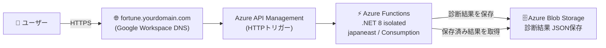
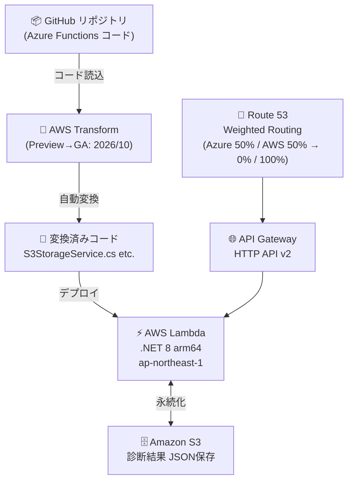

<!-- _class: title -->

# 🔮 おみくじを移行する
## AWS Transform で Azure Functions → Lambda

**クラウド移行診断おみくじAPI  PoC発表**
Level 300 技術勉強会

---

## 📋 アジェンダ（12分）

| 時間 | 内容 |
|------|------|
| 0:00〜1:00 | このLTの目的・アプリ紹介 |
| 1:00〜3:00 | デモアプリ構成（Azure） |
| 3:00〜5:00 | AWS Transform とは？ |
| 5:00〜7:00 | 🎬 ライブデモ① Azure で占う |
| 7:00〜9:00 | Transform 変換プロセス＋結果 |
| 9:00〜11:00 | 🎬 ライブデモ② 同じURLで AWS に切替 |
| 11:00〜12:00 | 比較・まとめ |

> **今日のゴール**: コードを書き直さずにクラウドを移行できるか、実際に試してみた話

---

## 🎰 クラウド移行診断おみくじAPI とは

> **「あなたの技術スタック、移行は大吉？それとも凶？」**

### 機能
- 🔽 使用技術をプルダウンで選択（Azure Functions, .NET 8, Blob Storage...）
- 📅 継続年数を入力 → **移行複雑度・成功確率を診断**
- ✨ 結果はおみくじ形式（大吉〜凶）＋ **AIご神託** 付き

### API エンドポイント
```
POST /api/assess       → 移行診断実行（複雑度・戦略・おみくじ）
GET  /api/assessment/{id} → 診断結果取得
GET  /api/ui           → ブラウザUI（そのまま触れる）
```

### デモURL
`fortune.yourdomain.com` → ブラウザで直接アクセス可能 🌐

---

## ☁️ Azure 構成（移行前）



**技術スタック**
- Azure Functions .NET 8 isolated（Consumption Plan）
- Azure Blob Storage（JSON 永続化）
- リージョン: japaneast

---

## 🤖 AWS Transform とは

### GA情報
- 📅 **2026年10月 GA予定**（2025年5月現在: Preview）
- 🔗 GitHub リポジトリ経由でコードを読み込み → 自動変換

### 変換対応マッピング

| Azure | → | AWS |
|-------|---|-----|
| Azure Functions | → | **AWS Lambda** (.NET 8, arm64) |
| Azure Blob Storage | → | **Amazon S3** |
| Azure Queue Storage | → | **Amazon SQS** |
| HTTP Trigger (APIM) | → | **API Gateway HTTP API v2** |

### ワークフロー
```
GitHubリポジトリ → AWS Transform → 変換済みコード → Lambda デプロイ
```

> ⚠️ まだPreviewのため、変換精度は [実測値・Phase 8完了後] に更新予定

---

## 🔄 変換対象コード解説

### Blob Storage → S3（主な変換箇所）

**変換前（Azure）**
```csharp
// BlobStorageService.cs
_client = new BlobServiceClient(connectionString);
await container.CreateIfNotExistsAsync();
await blob.UploadAsync(BinaryData.FromString(json));
```

**変換後（AWS Lambda）**
```csharp
// S3StorageService.cs
_s3 = new AmazonS3Client();
await _s3.PutObjectAsync(new PutObjectRequest {
    BucketName = _bucket,
    Key = $"{id}.json",
    ContentBody = json
});
```

> 💡 **ポイント**: ビジネスロジック（おみくじ判定・ご神託生成）はほぼそのまま！
> 変わるのはインフラ層のみ 🎯

---

## 🎬 ライブデモ① — Azure で動作確認

### 手順
1. `fortune.yourdomain.com` にアクセス
2. 使用技術をプルダウンで選択（例: **Azure Functions**, .NET 8）
3. 継続年数を入力（例: 3年）
4. 「診断する」ボタンをクリック

### 確認ポイント ✅

```json
{
  "fortune": "大吉",
  "strategy": "Replatform",
  "successProbability": 85,
  "source": "azure-functions",   ← ここを見る！
  "oracle": "クラウドネイティブの風が吹いています..."
}
```

> **`source: azure-functions`** ← 今はAzureで動いている証拠 🟦

---

## ⚙️ AWS Transform 変換プロセス



> **DNS切替はRoute 53 Weighted Routing** → コード変更ゼロでトラフィック移行 🎯

---

## 📊 変換結果サマリ

### 自動変換の実績

| 指標 | 値 |
|------|----|
| 🔄 自動変換率（ファイル数ベース） | `[実測値・Phase 8完了後]` |
| 🔧 ビルドエラー修正工数（行数） | `[実測値・Phase 8完了後]` |
| ✅ 機能互換率（テスト通過率） | `[実測値・Phase 8完了後]` |

### 主な変換済みファイル

| ファイル | 変換内容 |
|---------|---------|
| `BlobStorageService.cs` | → `S3StorageService.cs` |
| `Program.cs` | DI登録 Azure SDK → AWS SDK |
| `AssessmentFunction.cs` | HttpTrigger → Lambda Handler |
| `host.json` | → `aws-lambda-tools-defaults.json` |

> 💡 おみくじロジック・ご神託生成は **変換不要**（ビジネスロジック非依存）

---

## 🎬 ライブデモ② — 同じURLでAWSに切替

### DNS切替シナリオ

```
fortune.yourdomain.com
  ↓ Route 53 Weighted Routing
  ├── Azure Functions (weight: 0)   ← 切替後は0に
  └── API Gateway HTTP API v2 (weight: 100) ← こちらに全振り
```

### 確認ポイント ✅

```json
{
  "fortune": "大吉",
  "strategy": "Replatform",
  "successProbability": 85,
  "source": "aws-lambda-transform",  ← ここが変わった！
  "oracle": "クラウドネイティブの風が吹いています..."
}
```

> **`source: aws-lambda-transform`** ← URLそのままでAWSに切り替わった！ 🟧
> Google Workspace DNS + Route 53 委任で証明書も自動発行 🔒

---

## 📈 比較結果表

### 自動変換 vs 手動移植

| 比較観点 | 自動変換（Transform） | 手動移植（参考推定） |
|---------|----------------------|------------------|
| ⏱️ 移行総工数 | `[実測値・Phase 8完了後]` | `[推定値: 2〜3人日]` |
| 🔄 自動変換率 | `[実測値]` | — |
| 🚀 p50 レイテンシ | `[実測値]` | `[推定値: ほぼ同等]` |
| 📉 p95 レイテンシ | `[実測値]` | `[推定値: ほぼ同等]` |
| 💪 スループット（RPS） | `[実測値]` | `[推定値: arm64効果+15%]` |
| 💰 コスト（月額概算） | `[実測値]` | `[推定値: 同等〜-20%]` |

### 所感（現時点）

> 🟦 Azure SDK の **接続文字列管理** → 🟧 AWS の **IAM ロール** への思想転換が最大の壁
> ビジネスロジックは手を入れる必要なし 🎉

---

## 🎯 まとめ

### AWS Transform で何が変わったか

✅ **変換できたもの**
- ストレージ操作（Blob → S3）
- ホスティング設定（Functions → Lambda arm64）
- トリガー定義（HttpTrigger → API Gateway HTTP API v2）

🔶 **要確認だったもの**（`[実測値・Phase 8完了後]` で更新）
- 環境変数・シークレット管理（Key Vault → Secrets Manager）
- ログ設定（App Insights → CloudWatch）

### 今日のキーメッセージ

> 🔮 **「おみくじは Azure でも AWS でも同じ運勢を出す」**
> ビジネスロジックをクラウドから切り離せれば、移行は思ったより簡単かもしれない

---

## ❓ Q&A / 参考情報

### リポジトリ・リンク

| 項目 | URL |
|------|-----|
| 🔮 デモアプリ | `fortune.yourdomain.com` |
| 📦 GitHub | （社内リポジトリ） |
| 🤖 AWS Transform | [aws.amazon.com/transform](https://aws.amazon.com/transform) |

### おみくじ結果の判定ロジック（ネタバレ）

| 結果 | 条件 |
|------|------|
| 🎊 **大吉** | モダンスタック ＋ 継続1〜3年 |
| ✨ **吉** | 標準スタック ＋ 継続3〜5年 |
| 📖 **中吉** | 混在スタック ＋ 継続5〜8年 |
| 😅 **小吉** | レガシー混在 ＋ 継続8〜10年 |
| ⚠️ **凶** | レガシー中心 ＋ 継続10年超 |

> ありがとうございました！🙏

---
<!-- paginate: false -->

<div style="text-align:center; padding-top: 80px;">

# 🔮 Appendix

## Phase 8 完了後に更新するPLACEHOLDER一覧

| スライド | 項目 |
|---------|------|
| 9 | 自動変換率・ビルドエラー修正工数・機能互換率 |
| 11 | 移行総工数・p50/p95レイテンシ・RPS・コスト |
| 12 | 要確認項目の実測結果 |

> これらの値は **Phase 8（実測フェーズ）完了後** に `[実測値]` を置き換えてください

</div>
